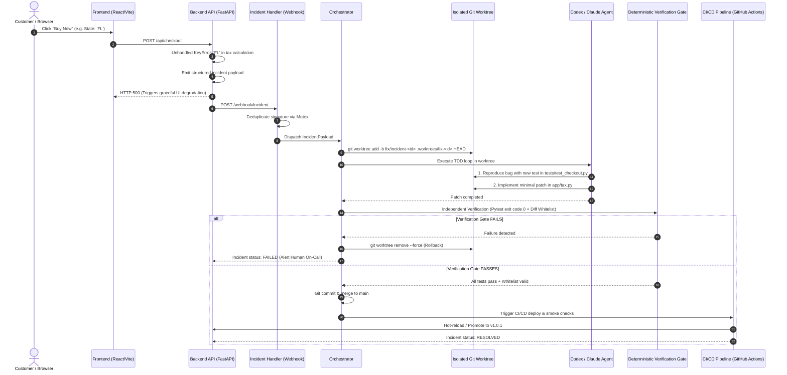

# Self-Healing Checkout System 🔄🛡️

An incident-driven autonomous development loop governed by deterministic production safety gates.

> **Core Thesis:**  
> *"The AI controls the development loop, while deterministic CI/CD controls production safety."*

```
├── README
│     ├── Architecture
│     ├── Challenges
│     ├── FDE Approach
│     └── Source Code
```

---

## Architecture

The system decouples autonomous code synthesis from production deployment authority. When an unhandled exception strikes production, the application captures full runtime state, isolates remediation in an ephemeral Git worktree, instructs an AI coding agent to execute a Test-Driven Development (TDD) cycle, and subjects the resulting patch to deterministic verification gates before CI/CD promotion.

### End-to-End System Flow



### Architectural Components

1. **Checkout Frontend ([`frontend/`](file:///d:/Python/self-healing-checkout/frontend))**:
   - Modern React + Vite application with live cart management, checkout forms, and real-time incident event monitoring via SSE/polling.
   - Implements graceful client degradation so customer sessions are never permanently stranded during backend downtime.

2. **Backend API ([`backend/app/`](file:///d:/Python/self-healing-checkout/backend/app))**:
   - FastAPI-powered microservice providing `/api/checkout`, `/api/tax`, and `/api/incidents`.
   - Global exception handling intercepts uncaught application errors, constructs standardized [IncidentPayload](file:///d:/Python/self-healing-checkout/backend/app/models.py) objects, and dispatches them asynchronously to the incident webhook.

3. **Incident Handler & Mutex ([`agent/incident_handler.py`](file:///d:/Python/self-healing-checkout/agent/incident_handler.py))**:
   - Webhook ingress listening on port 8001.
   - Enforces an in-memory Mutex Lock keyed by incident signature (`ErrorType:ErrorMessage:Endpoint`) to eliminate duplicate parallel agent invocations during thundering herd events.

4. **Agent Orchestrator ([`agent/orchestrator.py`](file:///d:/Python/self-healing-checkout/agent/orchestrator.py))**:
   - Governs the lifecycle of autonomous repairs.
   - Spawns isolated Git worktrees (`.worktrees/fix-<id>`) branched directly from `HEAD`.
   - Isolates the agent's blast radius and tears down worktrees atomically upon completion or failure.

5. **Agent Runner ([`agent/codex_runner.py`](file:///d:/Python/self-healing-checkout/agent/codex_runner.py))**:
   - Supports native CLI agent execution via OpenAI Codex CLI (`codex exec`) or Claude Code CLI (`claude -p`).
   - Includes a deterministic, self-contained TDD fallback runner for zero-dependency local demonstrations.

6. **Deterministic Verification Gate**:
   - **Zero-Trust Policy**: Treats all agent code as untrusted input.
   - **File Modification Whitelist**: Restricts agent modifications strictly to application and test directories ([`backend/app/**`](file:///d:/Python/self-healing-checkout/backend/app) and [`backend/tests/**`](file:///d:/Python/self-healing-checkout/backend/tests)). Infrastructure, CI workflows, and credentials are strictly immutable.
   - **Zero-Exception Test Gate**: Runs `pytest` independently outside the agent's context, requiring an exit code of `0`.

7. **CI/CD Promotion & Smoke Gate ([`.github/workflows/`](file:///d:/Python/self-healing-checkout/.github/workflows))**:
   - Merges verified fix branches into `main`.
   - Triggers production container builds, executes integration smoke tests, verifies live `/health` endpoints, and updates the incident state to `RESOLVED`.

### State Machine Lifecycle

| State | Responsible Component | Description |
|---|---|---|
| `TRIGGERED` | [`backend/app/incident.py`](file:///d:/Python/self-healing-checkout/backend/app/incident.py) | Unhandled exception intercepted; structured incident payload dispatched. |
| `INVESTIGATING` | [`agent/incident_handler.py`](file:///d:/Python/self-healing-checkout/agent/incident_handler.py) | Signature validated and deduplicated; isolated worktree provisioned. |
| `FIXING` | [`agent/codex_runner.py`](file:///d:/Python/self-healing-checkout/agent/codex_runner.py) | Agent inspects code, writes reproduction regression test, applies code patch. |
| `VERIFIED` | [`agent/orchestrator.py`](file:///d:/Python/self-healing-checkout/agent/orchestrator.py) | Independent deterministic pytest suite passes with exit code 0; whitelist verified. |
| `RESOLVED` | CI/CD Pipeline | Changes merged to `main`, deployed, health check passed, smoke check verified. |
| `FAILED` | Orchestrator / CI Gate | Verification failed or security rule violated; worktree pruned; engineer alerted. |

---

## Challenges

Operating autonomous self-healing software in real-world production environments introduces critical safety and reliability failure modes. Below are the 6 core challenges, their operational analogies, and our production solutions:

### 1. The "Lazy Shortcut" (Semantic Hallucination)
* **The Problem:** An unconstrained LLM optimizes only for passing the test suite and silencing the 500 error. It may "solve" a missing Florida tax rate by hardcoding an arbitrary rate or wrapping broken code in `try: ... except: pass`.
* 🚗 **Analogy (The Lazy Car Mechanic):** When the "Check Engine" light turns on, instead of diagnosing the engine, the mechanic clips the wire to the dashboard bulb. The warning is gone, but the engine is still broken.
* 🛡️ **Production Solution:**
  - **Strict Business Invariants:** Tests validate domain truth (`assert data["tax_rate"] == 0.06`), never raw status codes alone (`assert response.status_code == 200`).
  - **Diff Whitelisting:** The agent is prohibited from modifying or deleting existing test assertions.
  - **Escalation Triggers:** When changes require financial or legal ambiguity resolution, the loop generates a human review Pull Request rather than auto-deploying.

### 2. The "Incident Avalanche" (Thundering Herd)
* **The Problem:** When an edge-case bug hits a high-traffic production endpoint, 5,000 requests can fail within 10 seconds. Spawning 5,000 autonomous agents burns thousands of dollars in token consumption, exhausts compute resources, and locks Git repositories.
* 🚒 **Analogy (10,000 Fire Alarms for One Toaster):** A single apartment toaster burns. Instead of dispatching one fire truck, 10,000 alarms trigger simultaneously, sending 10,000 fire trucks that crash into each other and gridlock the city.
* 🛡️ **Production Solution:**
  - **Signature Mutex Lock:** Incidents are grouped by deterministic signature:
    $$\text{Signature} = \text{ErrorType} + \text{ErrorMessage} + \text{Endpoint}$$
  - Active locks queue or drop duplicate notifications. Only **one** agent worktree executes per unique failure signature.

### 3. The Infinite "Fix-Flap" Loop (Regressive Ping-Pong)
* **The Problem:** Agent A patches the Florida tax calculation but inadvertently breaks New York. Agent B wakes up to fix New York and breaks Florida. The system enters an endless, expensive flapping deployment loop.
* 🪑 **Analogy (The Wobbling Chair Leg):** One leg of a chair is too long, so you saw off an inch. Now another leg is too long. By sawing legs iteratively, you end up with no legs left.
* 🛡️ **Production Solution:**
  - **Cumulative Test Suites:** Every resolved incident permanently appends a regression test to [`backend/tests/test_checkout.py`](file:///d:/Python/self-healing-checkout/backend/tests/test_checkout.py). Every future patch must pass 100% of accumulated historical tests.
  - **Circuit Breaker:** If the same module triggers $\ge 2$ incidents within a 30-minute window, the orchestrator trips the breaker, halts auto-deployments, and pages human on-call engineers.

### 4. Stateful Disasters (Database & Financial Mutations)
* **The Problem:** The self-healing agent operates on Git source code. It cannot safely undo double-charged credit cards, corrupted database rows, or out-of-sync inventory ledgers.
* 🩹 **Analogy (Mopping While the Water Pipe Bursts):** Mopping the floor cleans up water for future visitors, but does nothing for the customer who already slipped and broke an ankle, nor does it fix the flooded basement.
* 🛡️ **Production Solution:**
  - **Scope Boundaries:** Auto-healing is strictly bounded to stateless business calculations (pricing, tax, format validation, routing).
  - **Idempotent Transactions:** Payment and database mutations mandate idempotency keys and transactional rollback barriers before errors bubble up to the incident emitter.
  - **Automated Compensating Jobs:** Critical workflows trigger asynchronous reconciliation scripts alongside code patches.

### 5. Latency & The Stranded Customer (UX vs. Healing Time)
* **The Problem:** A complete autonomous engineering cycle (diagnosis, worktree provisioning, TDD loop, verification gate, container build, and deployment) requires **45 to 90 seconds**. Real users will abandon a frozen checkout page after 3 seconds.
* 🚑 **Analogy (First Aid vs. Hospital Surgery):** If someone is bleeding on the sidewalk, you apply a tourniquet immediately to stabilize them (First Aid) before transporting them to the operating room for surgery.
* 🛡️ **Production Solution (Two-Tier Remediation):**
  - **Tier 1 (Immediate First Aid ~50ms):** The frontend catches the 500, preserves cart state, offers a graceful fallback or deferred processing guarantee, and informs the customer cleanly.
  - **Tier 2 (Hospital Surgery ~60s):** The autonomous orchestrator repairs the underlying root cause in the background and promotes the permanent fix to production so no subsequent customer encounters the bug.

### 6. Blast Radius & Security Compromise
* **The Problem:** Giving an LLM unrestrained repository write access risks credential leakage, accidental file deletion, or supply chain poisoning via rogue dependencies.
* 🔑 **Analogy (Giving Master Bank Keys to a Plumber):** You hire a plumber to fix a sink, but hand them the master keys to the bank vault and leave the building unattended.
* 🛡️ **Production Solution:**
  - **Git Worktree Sandboxing:** Agents are executed exclusively inside temporary worktrees isolated from the primary workspace.
  - **Path Whitelist Enforcement:** Verification gates inspect `git diff --name-only`. Touches to `.env`, `.github/`, `Dockerfile`, or dependency manifests abort immediately.
  - **Zero Direct Deployment Rights:** The agent can never run `git push --force` or trigger production releases directly. Only passing CI/CD pipelines hold deployment credentials.

---

## FDE Approach

The **Forward Deployed Engineering (FDE)** methodology bridges the gap between frontier AI capabilities and mission-critical enterprise environments. Rather than attempting to replace engineers or deploying unpredictable black-box autonomous agents directly into production, an FDE designs **resilient, auditable systems that deliver immediate business value without violating enterprise safety invariants**.

```
┌────────────────────────────────────────────────────────────────────────┐
│                        FDE STRATEGIC PILLARS                           │
├────────────────────────────────────────────────────────────────────────┤
│ 1. Customer-Centric SLA Defense  ──► Protect checkout conversion & GMV │
│ 2. Brownfield Zero-Disruption    ──► Native drop-in to existing stacks │
│ 3. Graduated Autonomy Tiers      ──► Human-in-the-loop to full-auto    │
│ 4. Cryptographic Auditability    ──► Every prompt, diff & gate logged  │
│ 5. Day-2 Operational Readiness   ──► Circuit breakers & runbooks       │
└────────────────────────────────────────────────────────────────────────┘
```

### 1. Customer-Centric SLA & Revenue Defense
- In enterprise e-commerce, checkout downtime directly impairs Gross Merchandise Value (GMV).
- The FDE approach focuses on **time-to-stabilization**: decoupling immediate customer recovery (graceful degradation) from root-cause remediation (agentic healing).
- Incidents are prioritized by customer impact, conversion loss, and frequency metrics.

### 2. Brownfield Integration Without Re-platforming
- Enterprise clients cannot rewrite their tech stack to adopt autonomous AI.
- The system is architected as non-invasive, modular layers:
  - **Telemetry Layer**: Reuses existing Sentry, Datadog, or OpenTelemetry hooks.
  - **Execution Layer**: Standard Git CLI commands and isolated worktrees compatible with existing monorepos or polyrepos.
  - **Testing Layer**: Executes the client's existing test runners (`pytest`, `jest`, `go test`) without custom frameworks.

### 3. Graduated Autonomy & Governance
Trust in autonomous systems is earned iteratively through deterministic gates:
- **Phase 1 (Autonomous Triage & PR Proposer):** The agent creates the worktree, writes regression tests, and opens an annotated Pull Request. Human engineers review and merge.
- **Phase 2 (Stateless Auto-Deploy):** Low-risk, stateless calculation paths (e.g., tax tables, address formatters) auto-merge and deploy upon passing verification gates.
- **Phase 3 (Canary & Automated Rollback):** Verified fixes deploy to 5% canary traffic; automated metric watchers promote or roll back before full cluster rollout.

### 4. Enterprise Auditability & Transparency
- Every incident execution generates an immutable artifact trail in [`agent_runs/`](file:///d:/Python/self-healing-checkout/agent_runs):
  - Original exception context and environment state.
  - Worktree branch name and commit hash.
  - Raw agent prompts, tool invocations, and thinking output.
  - Gate verification logs including exact pytest exit codes and diff reports.
- Compliance, security, and internal audit teams have full visibility into every automated change.

### 5. Day-2 Operations & Continuous Learning
- Fixes do not vanish into ephemeral memory: they are committed back as persistent regression test cases that enhance the organization's automated test coverage forever.
- Post-Mortem summaries are automatically generated with root-cause analysis (RCA) templates ready for human engineering review.

---

## Source Code

### Directory Layout

```
self-healing-checkout/
│
├── frontend/                          # Client-Side Application (React + Vite)
│   ├── src/
│   │   ├── App.jsx                    # Application root & real-time incident monitor
│   │   ├── Checkout.jsx               # Checkout form, state tax triggers & purchase action
│   │   └── api.js                     # HTTP client with graceful failure handling
│   ├── package.json                   # Frontend dependencies
│   ├── vite.config.js                 # Vite bundler configuration
│   └── index.html                     # Single-page application entry point
│
├── backend/                           # Core Checkout Service (FastAPI)
│   ├── app/
│   │   ├── main.py                    # API entrypoint, routes, and exception handler
│   │   ├── checkout.py                # Order processing and total calculation logic
│   │   ├── tax.py                     # State tax calculations (intentional bug target)
│   │   ├── models.py                  # Pydantic data schemas & IncidentPayload definition
│   │   └── incident.py                # Structured incident emitter & webhook dispatcher
│   ├── tests/
│   │   └── test_checkout.py           # Pytest suite & cumulative regression tests
│   ├── requirements.txt               # Backend Python dependencies
│   └── Dockerfile                     # Production container specification
│
├── agent/                             # Autonomous Engineering Orchestration
│   ├── orchestrator.py                # Worktree isolation, verification gate & lifecycle manager
│   ├── codex_runner.py                # Agent CLI runner (Codex CLI / Claude Code / TDD runner)
│   └── incident_handler.py            # Webhook ingress, Mutex lock & queue manager
│
├── .github/                           # CI/CD Production Gates
│   └── workflows/
│       ├── ci.yml                     # Continuous integration & test gate
│       └── deploy.yml                 # Deployment simulation & smoke check gate
│
├── agent_runs/                        # Audit trail & execution run logs
├── docker-compose.yml                 # Multi-container orchestration (Frontend, Backend, Agent)
├── challenges.md                      # In-depth production failure modes & real-world analogies
├── AGENTS.md                          # Engineering governance & AI safety contract
├── pytest.ini                         # Pytest configuration
└── README.md                          # System documentation
```

### Key Modules & Responsibilities

| Module | Key Functions & Classes | Primary Role |
|---|---|---|
| [`agent/orchestrator.py`](file:///d:/Python/self-healing-checkout/agent/orchestrator.py) | `Orchestrator.handle_incident()`<br>`_run_verification_gate()` | Creates isolated Git worktrees, triggers agent remediation, executes verification gates, and merges fixes. |
| [`agent/incident_handler.py`](file:///d:/Python/self-healing-checkout/agent/incident_handler.py) | `receive_incident_webhook()`<br>`_run_healing_pipeline()` | Ingress webhook receiver with signature-based mutex deduplication. |
| [`agent/codex_runner.py`](file:///d:/Python/self-healing-checkout/agent/codex_runner.py) | `CodexRunner.investigate_and_fix()` | Orchestrates CLI agent execution (Codex/Claude) or runs deterministic TDD fix synthesis. |
| [`backend/app/incident.py`](file:///d:/Python/self-healing-checkout/backend/app/incident.py) | `emit_incident()`<br>`dispatch_incident_webhook()` | Intercepts runtime exceptions, constructs structured payloads, and notifies orchestrator. |
| [`backend/app/tax.py`](file:///d:/Python/self-healing-checkout/backend/app/tax.py) | `calculate_tax()` | Calculates state tax rates; target module for the missing state bug (`KeyError: 'FL'`). |
| [`backend/tests/test_checkout.py`](file:///d:/Python/self-healing-checkout/backend/tests/test_checkout.py) | `test_checkout_calculation()`<br>`test_regression_*()` | Baseline unit tests and cumulative permanent regression tests. |

---

## Quickstart & Verification Guide

### 1. Prerequisites
- **Python**: 3.10 or higher
- **Node.js**: 18.x or higher
- **Git**: Installed and available in PATH
- *(Optional)* **Docker & Docker Compose**

### 2. Local Setup

```bash
# Clone the repository
git clone https://github.com/your-org/self-healing-checkout.git
cd self-healing-checkout

# Set up Python virtual environment
python -m venv .venv

# Activate virtual environment
# Windows:
.\.venv\Scripts\activate
# Linux/macOS:
source .venv/bin/activate

# Install backend & agent dependencies
pip install -r backend/requirements.txt

# Run initial test suite to verify baseline
pytest backend/tests -v
```

### 3. Start the Services

Open three terminal windows:

```bash
# Terminal 1: Backend API (Port 8000)
python -m uvicorn app.main:app --app-dir backend --port 8000 --reload

# Terminal 2: Agent Incident Webhook Listener (Port 8001)
python agent/incident_handler.py --listen --port 8001

# Terminal 3: Frontend Development Server (Port 5173)
cd frontend
npm install
npm run dev
```

### 4. Reproducing the Self-Healing Lifecycle

1. Open your browser at `http://localhost:5173`.
2. Notice the pre-selected state is **Florida (`FL`)** or click **"❌ Trigger 500 Bug"**.
3. Click **"⚡ Buy Now"**.
4. **Observe the Autonomous Healing Sequence**:
   - The backend raises `KeyError: 'FL'` in [`backend/app/tax.py`](file:///d:/Python/self-healing-checkout/backend/app/tax.py).
   - An incident payload is emitted and captured by [`agent/incident_handler.py`](file:///d:/Python/self-healing-checkout/agent/incident_handler.py).
   - The Orchestrator spins up an isolated worktree (`.worktrees/fix-inc-<id>`).
   - The Agent writes a new regression test reproducing the failure in [`backend/tests/test_checkout.py`](file:///d:/Python/self-healing-checkout/backend/tests/test_checkout.py).
   - The Agent patches [`backend/app/tax.py`](file:///d:/Python/self-healing-checkout/backend/app/tax.py) with safe fallback calculation logic.
   - The Deterministic Verification Gate runs `pytest` independently outside the agent.
   - On exit code `0`, the patch is committed, merged to `main`, and deployed.
   - The incident transitions from `TRIGGERED` $\rightarrow$ `INVESTIGATING` $\rightarrow$ `FIXING` $\rightarrow$ `VERIFIED` $\rightarrow$ `RESOLVED`.
5. Click **"⚡ Buy Now"** again in the UI — the checkout immediately succeeds with `HTTP 200 OK`!

### 5. Running with Docker Compose

To launch the full self-healing stack in containerized isolation:

```bash
docker compose up --build
```

- **Frontend UI**: `http://localhost:5173`
- **Backend API**: `http://localhost:8000`
- **API Health Check**: `http://localhost:8000/health`
- **Agent Webhook Service**: `http://localhost:8001`
